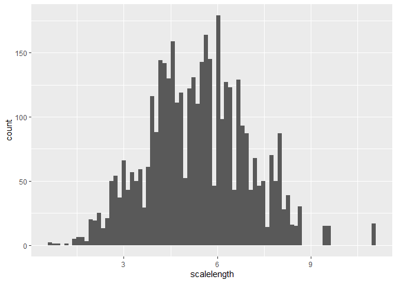

# Week 10 Fish Analysis
Alan Morales

## Fish Scale Analysis

Load the tidyverse and the data set

``` r
library(tidyverse)
```

    ── Attaching core tidyverse packages ──────────────────────── tidyverse 2.0.0 ──
    ✔ dplyr     1.2.1     ✔ readr     2.2.0
    ✔ forcats   1.0.1     ✔ stringr   1.6.0
    ✔ ggplot2   4.0.3     ✔ tibble    3.3.1
    ✔ lubridate 1.9.5     ✔ tidyr     1.3.2
    ✔ purrr     1.2.2     
    ── Conflicts ────────────────────────────────────────── tidyverse_conflicts() ──
    ✖ dplyr::filter() masks stats::filter()
    ✖ dplyr::lag()    masks stats::lag()
    ℹ Use the conflicted package (<http://conflicted.r-lib.org/>) to force all conflicts to become errors

``` r
fish_data <- read_csv("../data/Gaeta_etal_CLC_data.csv")
```

    Rows: 4033 Columns: 6
    ── Column specification ────────────────────────────────────────────────────────
    Delimiter: ","
    chr (2): lakeid, annnumber
    dbl (4): fish_id, length, radii_length_mm, scalelength

    ℹ Use `spec()` to retrieve the full column specification for this data.
    ℹ Specify the column types or set `show_col_types = FALSE` to quiet this message.

Observe the data set

``` r
head(fish_data)
```

    # A tibble: 6 × 6
      lakeid fish_id annnumber length radii_length_mm scalelength
      <chr>    <dbl> <chr>      <dbl>           <dbl>       <dbl>
    1 AL         299 EDGE         167            2.70        2.70
    2 AL         299 2            167            2.04        2.70
    3 AL         299 1            167            1.31        2.70
    4 AL         300 EDGE         175            3.02        3.02
    5 AL         300 3            175            2.67        3.02
    6 AL         300 2            175            2.14        3.02

Summary statistics for fish scale length

``` r
fish_data |> 
  summarize(min_scale_length = min(scalelength, na.rm = T), max_scale_length = max(scalelength, na.rm = T), mean_scale_length = mean(scalelength, na.rm = T))
```

    # A tibble: 1 × 3
      min_scale_length max_scale_length mean_scale_length
                 <dbl>            <dbl>             <dbl>
    1            0.628             11.0              5.38

\# Question 3 - Remove fish with scale lengths below 1 mm

``` r
fish_filtered <- fish_data |> filter(scalelength >= 1)

nrow(fish_filtered)
```

    [1] 4029

``` r
write_csv(fish_filtered, "../data/fish_filtered.csv")

fish_filtered
```

    # A tibble: 4,029 × 6
       lakeid fish_id annnumber length radii_length_mm scalelength
       <chr>    <dbl> <chr>      <dbl>           <dbl>       <dbl>
     1 AL         299 EDGE         167            2.70        2.70
     2 AL         299 2            167            2.04        2.70
     3 AL         299 1            167            1.31        2.70
     4 AL         300 EDGE         175            3.02        3.02
     5 AL         300 3            175            2.67        3.02
     6 AL         300 2            175            2.14        3.02
     7 AL         300 1            175            1.23        3.02
     8 AL         301 EDGE         194            3.34        3.34
     9 AL         301 3            194            2.97        3.34
    10 AL         301 2            194            2.29        3.34
    # ℹ 4,019 more rows

``` r
scalelength_plot <- ggplot(fish_data, aes(x = scalelength)) +
  geom_histogram(bins=80)
scalelength_plot
```



``` r
ggsave("../code/scale_hist_by_length.jpg", plot = scalelength_plot)
```

    Saving 7 x 5 in image
